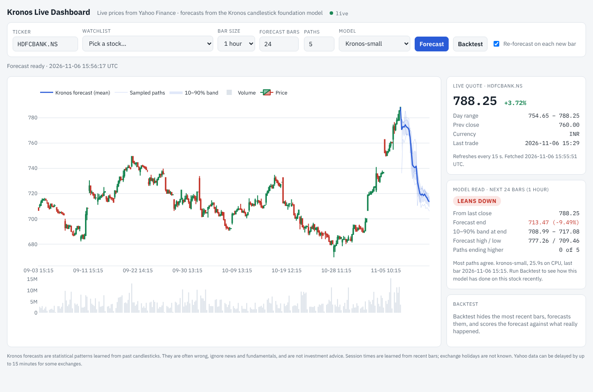
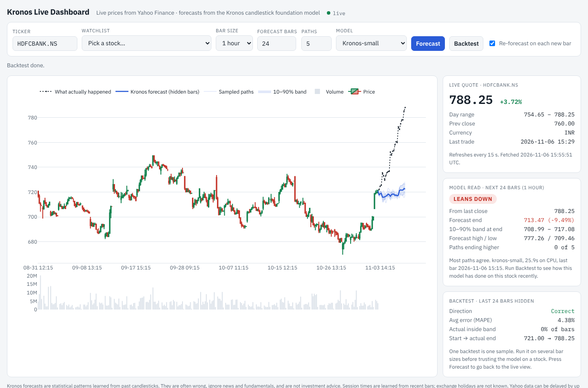

# Kronos Live Dashboard

A live stock dashboard built on **[Kronos](https://github.com/shiyu-coder/Kronos)**, an open-source
foundation model trained on candlestick (K-line) data from 45+ exchanges.



## What it does

- **Live quote** for any Yahoo Finance ticker: `HDFCBANK.NS`, `RELIANCE.NS` (NSE), `500180.BO` (BSE), `AAPL`, `NVDA` (US),
  `7203.T` (Tokyo), `ASML.AS`, `BTC-USD`… Refreshes every 15 s.
- **Candlestick chart** with volume: 5-minute, 15-minute, 1-hour or daily bars.
- **Kronos forecast** of the next 4–120 bars. Several paths are sampled, so you see the mean forecast, a 10–90% band
  and each sampled path, not just one line. Forecast bars land only on real trading hours (learned from recent bars).
- **Model read**: whether the forecast leans up, down or flat, the expected end price, and how many paths agree.
- **Re-forecast on each new bar**: the page checks for a new bar every 60 s and re-runs Kronos when one closes.
- **Backtest**: hides the latest bars, forecasts them, and scores the forecast against what really happened
  (direction, average error, share of bars inside the band).



Watchlist presets come from `../market-radar/config/watchlist.json` (India, US, Europe & Asia), plus BTC and ETH.

## Run it

```bash
cd kronos-dashboard
./setup.sh      # once: clones Kronos, makes .venv, installs CPU PyTorch + deps (~1 GB)
./run.sh        # serves http://localhost:7860
```

The first forecast downloads the model from Hugging Face (Kronos-small is about 100 MB). On a laptop CPU a
24-bar forecast with 5 paths takes roughly 10–30 s; Kronos-mini is faster.

Network hosts it needs: `huggingface.co` and its CDN (`us.aws.cdn.hf.co`), `query1/query2.finance.yahoo.com`,
`download.pytorch.org` (setup only).

## API

| Endpoint | Returns |
|---|---|
| `GET /api/quote?ticker=` | last price, % change, day range |
| `GET /api/history?ticker=&interval=&bars=` | OHLCV bars |
| `GET /api/forecast?ticker=&interval=&horizon=&paths=&model=` | mean forecast, band, paths, summary |
| `GET /api/backtest?…same…` | forecast of the hidden last bars vs actual, with scores |

## Limits

Kronos only sees past prices and volume. It knows nothing about news, results or fundamentals, and its
forecasts are often wrong, so always check the Backtest on a stock before giving a forecast any weight.
Yahoo prices can be delayed up to 15 minutes on some exchanges, and exchange holidays aren't modelled.
This is a research tool, not investment advice.
